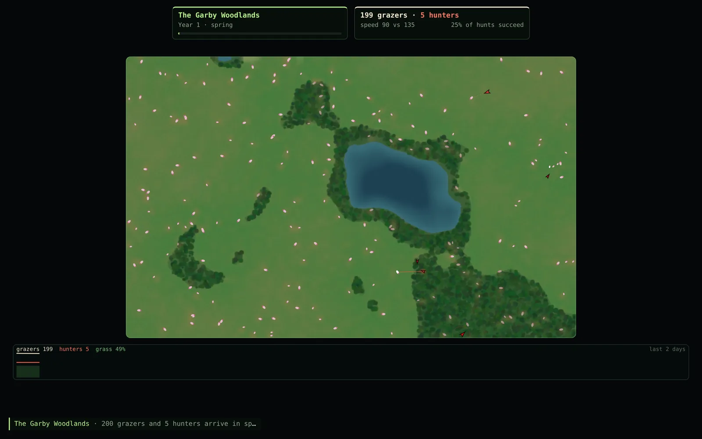
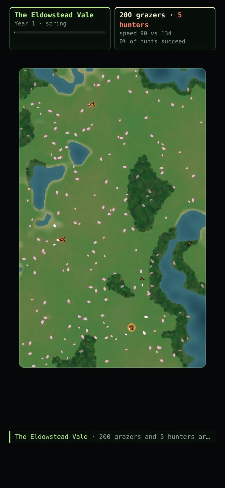

# Random Ecosystems

[](https://github.com/ali-raheem/random-ecosystems/actions/workflows/ci.yml) [](https://github.com/ali-raheem/random-ecosystems/actions/workflows/pages.yml)

**▶ Try it live: [shoryuken.me/eco](https://shoryuken.me/eco/)** · mirror on [GitHub Pages](https://ali-raheem.github.io/random-ecosystems/) · installable, works offline

<p align="center">
  <a href="https://shoryuken.me/eco/"></a>
  <a href="https://shoryuken.me/eco/"></a>
</p>

Endless generated worlds of grass, grazers and hunters. Each world has lakes, woodland and
meadows, and runs through seasons, droughts and wildfires. The two species rise and fall in
predator–prey cycles, and their genes drift in an evolutionary arms race. Made for leaving
on as a screensaver. Installable, and works offline.

## What you're looking at

- **The map:** lakes (blue), woodland (dark green), and meadow whose colour shows how much
  grass is left. Brown patches have been grazed down, and black ones have burnt and are
  growing back lush. The tint follows the seasons, and winter is frosted.
- **Grazers** are pale ovals, tinted by lineage. They flash white when they bolt.
- **Hunters** are red arrowheads. A dashed line shows a hunter stalking; a solid line and a
  glow show it sprinting. A red ring marks a kill, and small rings mark births.
- **The chart** along the bottom shows grazers (cream), hunters (red) and grass cover (green)
  over the last few years, with a line at the start of each year.
- **The feed** narrates the world: population peaks and crashes, droughts, fires, migrants,
  and, each spring, how far each species' genes have drifted.

## The model

- The land is a grid of 15 m cells built from layered value noise: elevation (low ground
  floods into lakes) and moisture (damp ground is fertile and grows woodland).
- Grass regrows towards each cell's capacity, fast in spring and summer, hardly at all in
  winter, and at 30% in a drought. Fires spread through dry, grassy cells.
- Every animal has genes for top speed, sensing range, body size and a lineage hue. Each one
  is copied with a small mutation at birth. Genes cost energy: body upkeep, sprinting muscle,
  movement and (for grazers) vigilance. So selection balances them rather than maxing them out.
- Grazers forage, herd, and flee hunters they notice. They notice late with their head down,
  and a frightened grazer heads for the woods, where hunters only see it up close. They breed
  in spring and early summer.
- Hunters track herds, stalk, pounce and give up on long chases. A kill feeds them for days.
  They raise one litter a year, and only with a territory to themselves.
- The result is a predator–prey cycle of roughly eight years, like the lynx and the snowshoe
  hare. If a species dies out, a few migrants arrive after a while, so a world never stops.

A world comes from its seed, so a `#seed=` link replays it exactly.

## Controls

Space pause · +/− speed (½× to 8×; 1× is a day per second) · N new world · G field guide ·
S settings · K hunt lines · M sound · F fullscreen · H hide the interface.

## Run it

```bash
npm run serve   # python3 -m http.server 8080
npm test        # node --test, no dependencies
```
